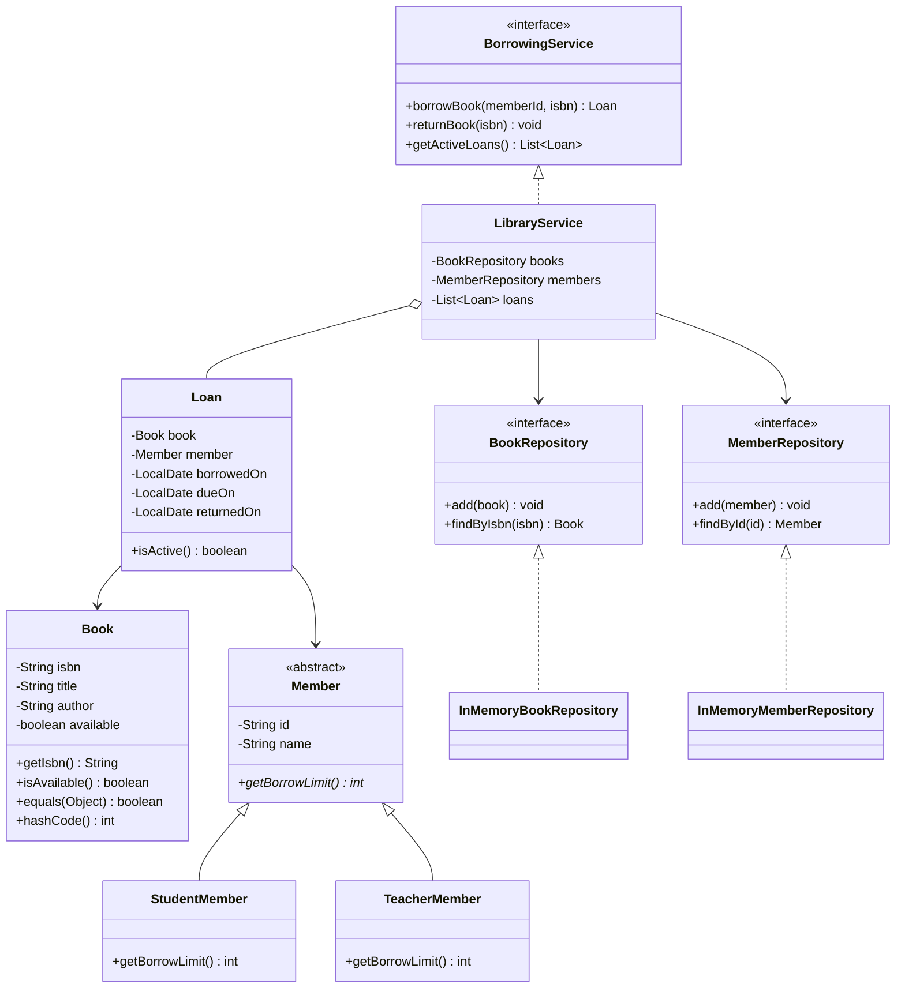

# Library Management System — UML Class Diagram

Open this file on GitHub or in a Markdown preview that supports Mermaid diagrams.

## Legend
- Solid triangle (`<|--`) = inheritance (`extends`)
- Dashed triangle (`<|..`) = interface implementation (`implements`)
- Arrow = uses/depends on
- Asterisk after `getBorrowLimit()` indicates an abstract method
